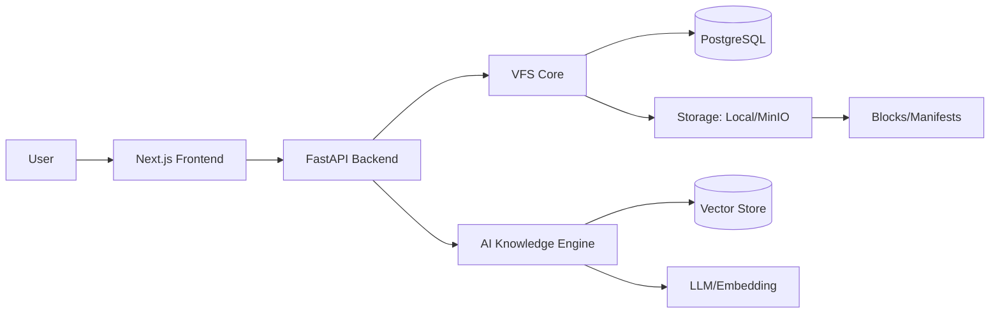
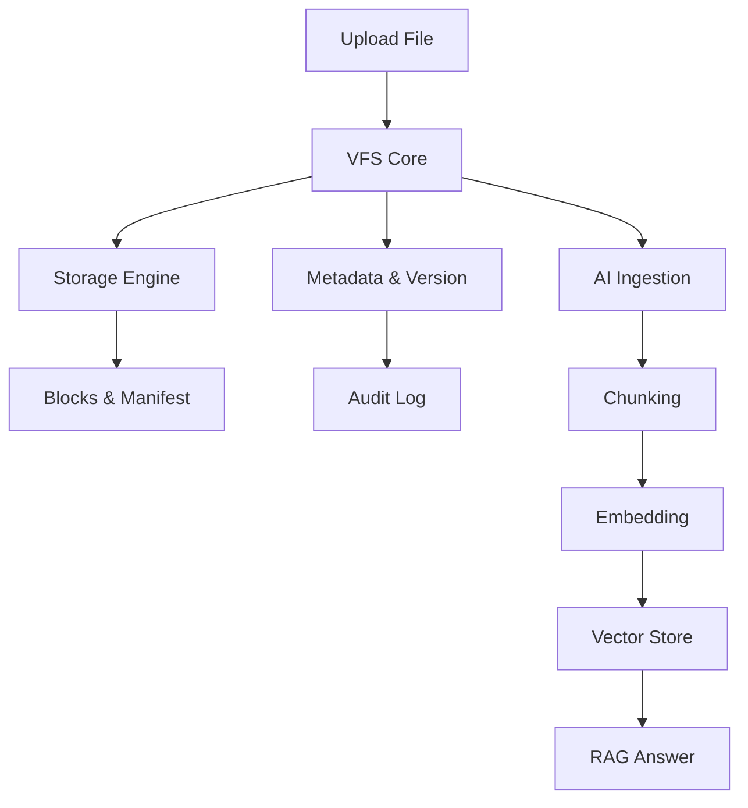
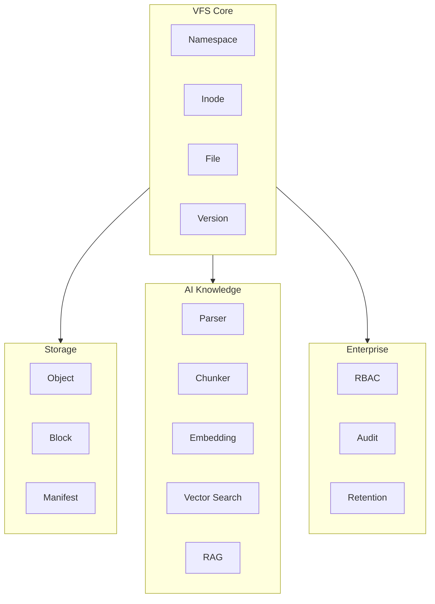
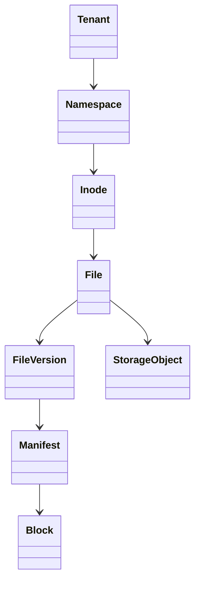
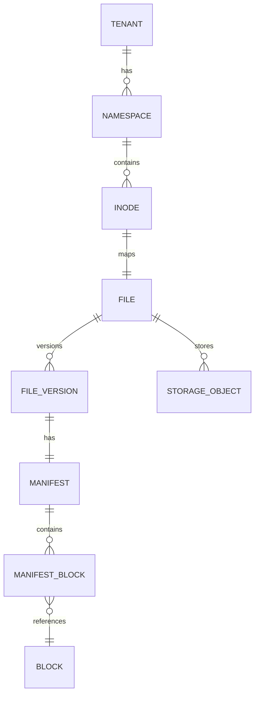

# VFS AI Knowledge System

Unified platform for managing files, storage, metadata, versions, and AI knowledge.

## Architecture

- VFS Core: namespaces, inodes, files, directories
- Storage Engine: local/MinIO, blocks, manifests, dedup, integrity
- Metadata & Versioning: metadata, lifecycle, RBAC, audit, retention
- AI Knowledge: parsing, chunking, embedding, vector search, RAG
- Frontend: Next.js + Tailwind
- Backend: FastAPI + PostgreSQL

## 
## 

## Architecture Diagram

## Workflow Diagram

## Components & Features

## Class Diagram

## Database Diagram

## AI Agent

- Provider Manager with quota/rate limit/budget
- Providers: OpenAI, Anthropic, Gemini
- DB usage tracking
