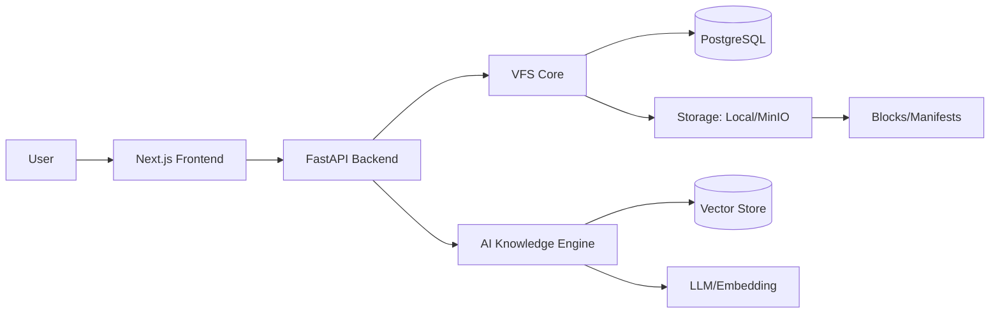
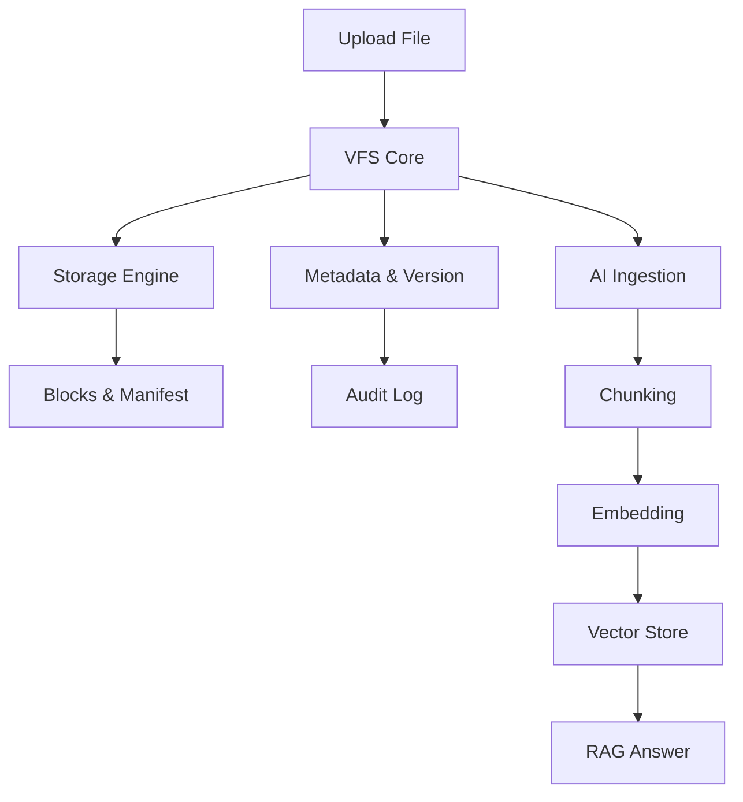
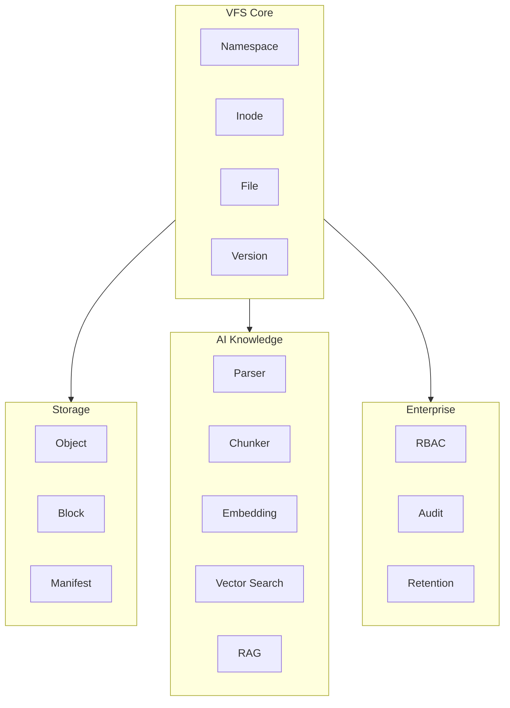

# VFS AI Knowledge System

Unified platform for managing files, storage, metadata, versions, and AI knowledge.

## Architecture

- VFS Core: namespaces, inodes, files, directories
- Storage Engine: local/MinIO, blocks, manifests, dedup, integrity
- Metadata & Versioning: metadata, lifecycle, RBAC, audit, retention
- AI Knowledge: parsing, chunking, embedding, vector search, RAG
- Frontend: Next.js + Tailwind
- Backend: FastAPI + PostgreSQL

## Workflow

Upload -> VFS -> Storage -> Blocks/Manifest -> Metadata/Version -> AI Ingestion -> RAG Answer

## Features

- File CRUD, upload/download, versioning
- Tag, keyword, metadata management
- Block storage with SHA-256 integrity
- Chatbot connected to VFS search
- Enterprise governance: RBAC, audit, retention


## Architecture Diagram



## Quick Start

```bash
docker compose up -d
cd backend && DEBUG=false python -m uvicorn app.main:app --reload
cd frontend && npm run dev
```

## API

- /api/vfs/* : file operations
- /api/chat : chatbot
- /health : status

## Testing

Frontend: npm run build
Backend: python -m uvicorn app.main:app


## Workflow Diagram




## Components & Features


